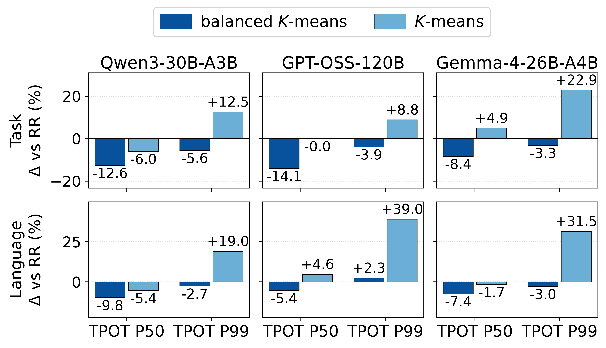

# Cluster balance — five-rate camera-ready figure

[PNG](cluster_balance_five_rates.png) · [PDF](cluster_balance_five_rates.pdf)



ELDR’s balanced K-means (left) versus vanilla K-means as an ablation (right).
Bars show the equal-weight mean of the matched RR-relative percentage change
at **20, 40, 60, 80, and 100 req/s**, separately for each model and workload.
**Negative means lower latency.** Only TPOT P50 and P99 are plotted.
The original paper renderer, colors, layout, and embedded TrueType fonts are retained.

The figure contains **90 measured cells**: 18 preserved 60 req/s cells from
`run-2cpu-rr-eldr` and 72 fresh 20/40/80/100 req/s cells from
`run-2cpu-ablations-rates`. Warmups are excluded. These are single measurements
per configuration, not repeated-trial averages or confidence intervals.
Requests are not pooled across rates. Raw hashes, recomputed metrics, source/input
hashes, runtime/cache/refit settings, and cleanup were checked before plotting.

Both variants use online refitting (5 s history, 1 s interval), Full signatures,
tau-band JSQ (tau = 0.1), two proxy CPU cores (4–5), prefix caching enabled,
8P16D, traffic seed 1234, and 512 output tokens. The balanced/vanilla choice
applies to both the initial fit and online refits.

Balanced K-means improves the five-rate mean relative to vanilla K-means in all
six model/workload pairs for both plotted metrics. It does not guarantee an
improvement over RR: GPT-OSS Language P99 is **+2.34%** versus RR with balanced
K-means and **+39.01%** with vanilla K-means. Individual-rate exceptions remain
visible in the linked data; averages should not be read as all-rate guarantees.

## Data and provenance

- [Task measurements](cluster_balance_five_rates-task.csv) and [Language measurements](cluster_balance_five_rates-language.csv): absolute metrics, raw SHA-256 hashes, and each row’s `source_run`.
- [Per-rate changes](per_rate_changes.csv): matched RR-relative percentages, including TPOT P95 and TTFT P50.
- [Five-rate means](mean_changes.csv): the same percentage units; metric column names identify the underlying latency metric, not the units of these changes.
- [Source runs and hashes](source_runs.json) and [validation record](validation.json).
- [Workspace validation/plot driver](validate_and_plot.py): requires the original author-side run directories; it does not launch experiments.

No reviewer measurements, paused runs, TTFT diagnostics, or other experiments
are included. The earlier 60 req/s figure is preserved. This results-only update
does not change the paper, artifact main branch, or running experiments.

## Redraw without the original runs

From a Python environment with NumPy and Matplotlib:

```bash
.venv/bin/python -B results/camera-ready-20261011-cluster-balance/render.py --output /tmp/eldr-cluster-redraw
```

Choose an output directory that does not already exist. The adjacent JSON data
and bundled `renderer/` are sufficient. The renderer is copied from the measured
checkout; its only portability edit changes the shared-style import to the
bundled module. The original renderer hashes are recorded in `source_runs.json`.
