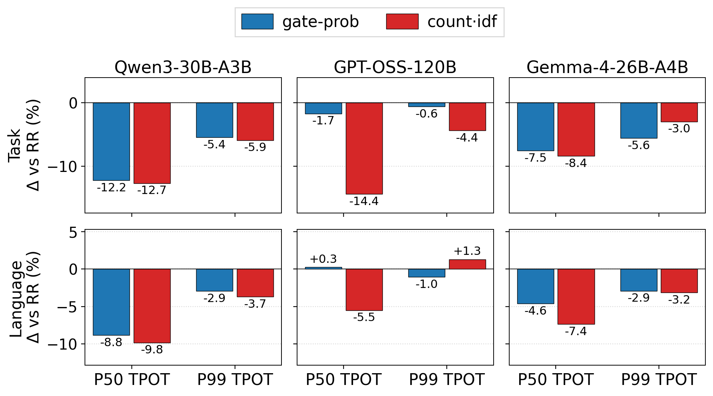
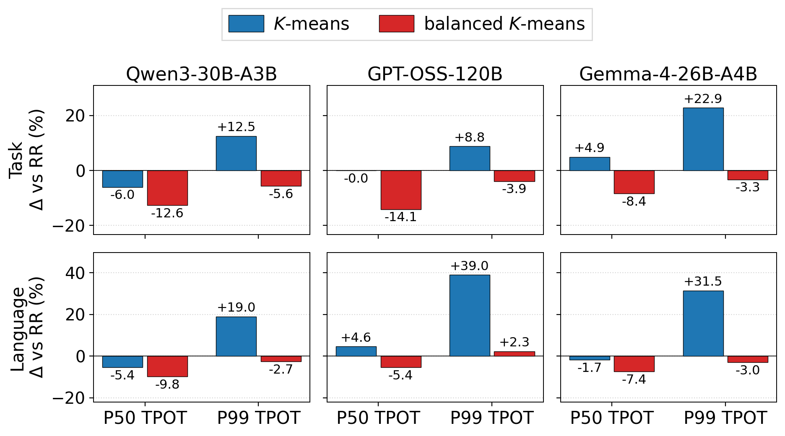
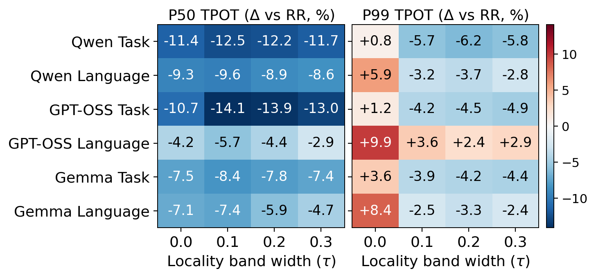

# Design validation — five-rate camera-ready figures

| Experiment | Preview | Vector figure |
| --- | --- | --- |
| Expert signature | [PNG](signature.png) | [PDF](signature.pdf) |
| Cluster balance | [PNG](cluster_balance.png) | [PDF](cluster_balance.pdf) |
| Locality band | [PNG](locality_band.png) | [PDF](locality_band.pdf) |

Each value is the average of the matched RR-relative percentage changes at
**20, 40, 60, 80, and 100 req/s**, separately for each model, workload and
variant: `mean(100 * (candidate / matched_RR - 1))`. **Negative is faster.**
Requests are not pooled across rates. P50 and P99 are shown; P95 and TTFT P50
are retained in the linked data. Signature variants have separate matched RR
controls from their own worker groups.

The figures cover **360 measured cells**: signature 120, cluster balance 90,
and locality band 150, including RR controls. They combine 72 preserved
60 req/s cells with 288 fresh 20/40/80/100 req/s cells. Warmups are excluded.
All use 8P16D, prefix caching, two proxy cores (4–5), online history/refitting
at 5 s/1 s, traffic seed 1234, fit seed 1, and 512 output tokens. The signature
comparison uses greedy layer selection for each transform. The clustering
and locality studies use Full signatures; clustering uses tau = 0.1, while
the locality study varies tau with balanced K-means.

## Interpretation

- **Signature:** count·idf has the larger mean median-TPOT reduction relative
  to its matched RR in all six model/workload pairs. The advantage over
  gate-prob ranges from 0.5 to 12.7 percentage points. Gate-prob has better
  mean P99 results on Gemma Task and GPT-OSS Language. This compares complete
  signature designs; it does not isolate IDF or layer-mask contributions.
- **Cluster balance:** balanced K-means improves both mean metrics relative
  to vanilla in all six pairs. Vanilla mean P99 is 8.8–39.0% worse than RR;
  balanced K-means still has a 2.3% P99 regression on GPT-OSS Language.
- **Locality band:** tau = 0.1 gives the best mean median result in all six
  pairs. Tau = 0 worsens mean P99 relative to RR in every pair. Wider bands
  give better mean P99 than 0.1, so 0.1 is a median/tail tradeoff, not a
  universal optimum. GPT-OSS Language P99 at 0.1 remains 3.6% worse than RR.

These are single measurements per configuration, not repeated-trial means
or confidence intervals. Small differences are not evidence of statistical
significance. The averages do not imply improvement at every individual rate;
all rates, including regressions, remain in the per-rate data.

## Data and provenance

- [Per-rate changes](per_rate_changes.csv) and [five-rate means](mean_changes.csv).
  Values are percentages even though the underlying metric column names end
  in `_ms`.
- [Source measurements](data/) retain absolute metrics, raw SHA-256 hashes and
  each row's `source_run`; [source runs](data/source_source_runs.json) identify
  the preserved and fresh runs.
- [Validation record](validation.json): 360 source rows, 240 matched per-rate
  comparisons and 48 five-rate means. The original publication-state flags
  describe the local graph-creation stage, before this upload.
- [Author-side validation/render driver](render.py) and its frozen
  [renderers](renderer/). The driver requires the original author-side paths
  and a fresh output directory; it is not a standalone reproduction command.
- [Paper plotting sources and redraw instructions](https://github.com/fzheart/ELDR-ATC26/tree/fc42d6f1bce2f6c9ee4b8a9b23a57a38dc3f1b3a/plots)
  regenerate these same images from the bundled compact inputs, without
  access to the author-side raw runs. The paper includes vector PDFs.

The inputs exclude Reviewer Alpha, paused older runs, and instrumented
overhead/TTFT diagnostics. No experiments were started, modified or rerun to
produce this publication. Existing 60 req/s evidence remains preserved.

## Signature

## Cluster balance

## Locality band

