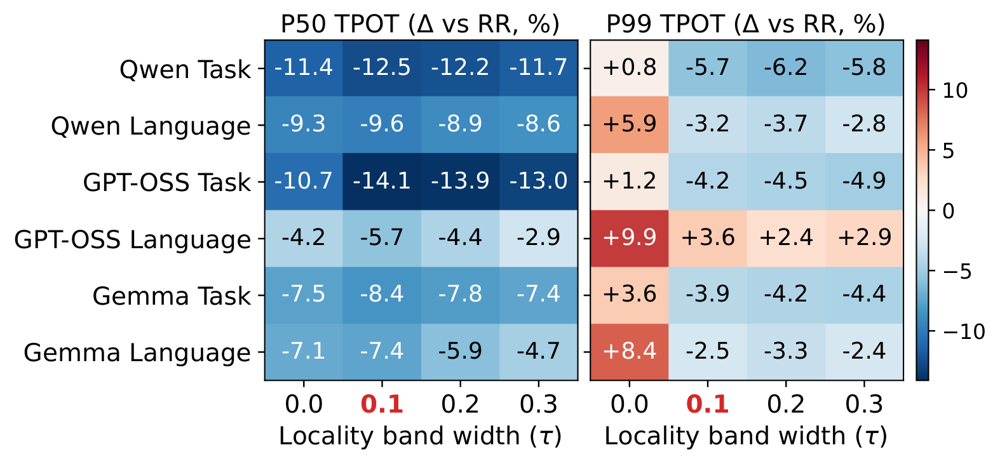

# Unified paper figures — October 11, 2026

All 19 paper figures redrawn from their plotting code or HTML diagrams, with
embedded DejaVu Sans text. No PDF-to-vector conversion or text outlining is used.
RR is blue (`#1f77b4`) and ELDR is red (`#d62728`) in policy comparisons;
P2C is orange (`#ff7f0e`) in the main figures. The approved main-result
axes are preserved: matching P50/P99 axes per model, and at least three integer
TTFT ticks. RR curves and markers are drawn above overlapping baseline curves.
ELDR configurations are red/right and comparison configurations blue/left in
the signature and cluster-balance bar charts and legends; legend labels give
only the configuration names, without an "ELDR" suffix. The signature-quality
chart also places count·idf last in red. Locality-band heatmap colors retain
their signed-value meaning; all band-width ticks use the same neutral styling.
Fig. 4 uses blue mixed-domain and red same-domain curves, with extra space
between the legend and model titles. Fig. 8 uses blue for Task and red for
Language, with a shared 0.58–0.90 y-axis and all measured values and peaks retained.
ACM document spacing is unchanged.

The PDFs below are the paper assets; the PNGs are previews rendered from those
exact PDFs. Plotting sources, compact inputs and font-license notices are in
[`plots/`](plots/README.md). See [`font-audit.json`](font-audit.json): all 19
figures have embedded, searchable text and no Type 3 fonts. The updated paper
also compiled successfully to 16 pages with no Type 3 or unembedded fonts.
The main-curve revision was checked against the previous PDFs: all drawing
geometry, labels, ticks and colors are identical; only stacking order changed.
Ablation checks confirm unchanged measurements, bar heights, whiskers, axes
and heatmap cells despite the color/order updates. No new results are substituted.
Fig. 6 separates initialization, the numbered request path and asynchronous
background centroid refitting. Its router box is labeled only "ELDR Router";
the signature-return and KV-transfer labels are separated. The fixed transform
is explained in the paper text, not inside the router box.
Paper update:
[`3f082a8`](https://github.com/fzheart/ELDR-ATC26/commit/3f082a8fa50be4883282aaadb0aa256992610239).

## Locality band: newly validated five-rate results

[Open PNG](figure/06_evaluation/fig_tau_ablation.png) ·
[Download PDF](figure/06_evaluation/fig_tau_ablation.pdf)

150 measured cells: 30 preserved cells at 60 req/s plus 120 fresh cells at
20/40/80/100 req/s, across three models, two workloads, RR and four band widths.
Each heatmap entry is the equal-weight mean of per-rate matched RR-relative
percentage changes, not a pooled-request statistic. Negative is better.

The 0.1 band has the largest mean P50 reduction in all six model/workload pairs.
It does not guarantee the best tail: GPT-OSS Language still has a mean P99
regression of 3.6%, and wider bands sometimes improve P99 further. Individual
rate results and regressions remain available in the data; they are not removed.

- [Per-rate changes](plots/data/locality_band_per_rate_changes.csv)
- [Five-rate means](plots/data/locality_band_mean_changes.csv)
- [Input/run provenance](plots/data/locality_band_source_runs.json)
- [Validation record](plots/data/locality_band_validation.json)
- [Raw-input validator used](validate_locality_inputs.py) — requires the original
  raw run directories; the portable plotting scripts do not.

Validation rechecked raw counts, hashes and metrics; saved source/input hashes;
proxy CPU affinity, cache and engine flags; routing/refit status; and cleanup.
This publication neither launches experiments nor changes the running queue.

## All figures

| Fig. | Content | Preview | Paper asset |
| --- | --- | --- | --- |
| 1 | Domain expert heatmaps | [PNG](figure/03_motivation/domain_2x3_layer.png) | [PDF](figure/03_motivation/domain_2x3_layer.pdf) |
| 2 | MoE layer latency | [PNG](figure/03_motivation/moe_latency.png) | [PDF](figure/03_motivation/moe_latency.pdf) |
| 3 | Prefill–decode agreement | [PNG](figure/03_motivation/pd_scatter.png) | [PDF](figure/03_motivation/pd_scatter.pdf) |
| 4 | Active experts vs. batch size | [PNG](figure/03_motivation/active_experts_sweep.png) | [PDF](figure/03_motivation/active_experts_sweep.pdf) |
| 5 | Language distribution | [PNG](figure/03_motivation/wc_langdist.png) | [PDF](figure/03_motivation/wc_langdist.pdf) |
| 6 | ELDR overview | [PNG](figure/04_design/fig_overview.png) | [PDF](figure/04_design/fig_overview.pdf) |
| 7 | Signature transform | [PNG](figure/04_design/sig_transform.png) | [PDF](figure/04_design/sig_transform.pdf) |
| 8 | Layer selection | [PNG](figure/04_design/sig_layers.png) | [PDF](figure/04_design/sig_layers.pdf) |
| 9 | Cluster PCA | [PNG](figure/04_design/cluster_pca.png) | [PDF](figure/04_design/cluster_pca.pdf) |
| 10 | Prefix-signature coherence | [PNG](figure/04_design/fig_prefix_coherence.png) | [PDF](figure/04_design/fig_prefix_coherence.pdf) |
| 11 | Main Task | [PNG](figure/06_evaluation/fig_main_task.png) | [PDF](figure/06_evaluation/fig_main_task.pdf) |
| 12 | Main Language | [PNG](figure/06_evaluation/fig_main_lang.png) | [PDF](figure/06_evaluation/fig_main_lang.pdf) |
| 13 | Active-expert reduction | [PNG](figure/06_evaluation/fig_expert_reduction.png) | [PDF](figure/06_evaluation/fig_expert_reduction.pdf) |
| 14 | Signature ablation | [PNG](figure/06_evaluation/fig_transform_ablation.png) | [PDF](figure/06_evaluation/fig_transform_ablation.pdf) |
| 15 | Cluster balance | [PNG](figure/06_evaluation/fig_cluster_ablation.png) | [PDF](figure/06_evaluation/fig_cluster_ablation.pdf) |
| 16 | Locality band | [PNG](figure/06_evaluation/fig_tau_ablation.png) | [PDF](figure/06_evaluation/fig_tau_ablation.pdf) |
| 17 | Prefix cache | [PNG](figure/06_evaluation/fig_prefix_cache_gptoss_task.png) | [PDF](figure/06_evaluation/fig_prefix_cache_gptoss_task.pdf) |
| 18 | Workload drift | [PNG](figure/06_evaluation/fig_workload_drift.png) | [PDF](figure/06_evaluation/fig_workload_drift.pdf) |
| 19 | Larger model | [PNG](figure/06_evaluation/fig_qwen235_2p8d.png) | [PDF](figure/06_evaluation/fig_qwen235_2p8d.pdf) |

Quick galleries: [1–6](gallery-1.png), [7–12](gallery-2.png), [13–18](gallery-3.png).

Cluster balance uses its validated 90-cell five-rate dataset. Main Task and
Language each use 90 validated cells; Prefix cache uses four 100 req/s cells.
Other figures retain their existing measurement inputs. In particular, Signature
still shows its existing 60 req/s data, and Drift is the previously selected
round-1 comparison, not the pending new experiments. See the
[source/input inventory](plots/README.md) for details. No Reviewer Alpha,
paused-run or instrumented-diagnostic results were silently merged.
